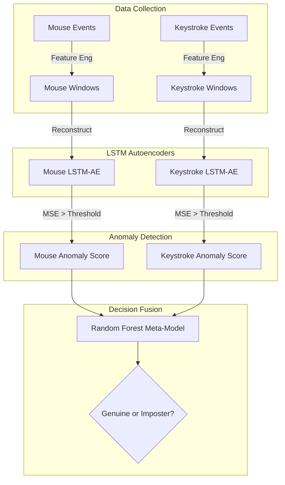

# Behavioral Guard: Continuous Authentication
**Mid-Semester Review (Phase 1)**

## 1. The Problem
Traditional authentication (passwords, pins, fingerprints) only verifies identity at the moment of login. Once logged in, the session is trusted indefinitely. If someone else takes over the keyboard, the system doesn't know.

## 2. Our Solution: Continuous Behavioral Biometrics
We built a system that continuously verifies identity in the background by learning **how** you type and **how** you move your mouse, treating authentication as a **One-Class Anomaly Detection** problem.

### Modalities Tracked
*   **Mouse Kinematics:** Velocity, acceleration, jerk, curvature, movement bearing.
*   **Keystroke Dynamics:** Dwell time (how long a key is held) and flight time (latency between keys).

## 3. System Architecture

## 4. Current Pipeline Status (100% Functional)
*   [x] Background Data Loggers (Mouse & Keyboard)
*   [x] Sliding Window Feature Engineering 
*   [x] Unsupervised LSTM-Autoencoder training (One-class learning)
*   [x] Fixed-Time Bucket Decision-Level Fusion
*   [x] Evaluation & Metrics Engine

## 5. Next Steps for End-Sem (Phase 2)
1.  **AI Modality Alignment:** Using Generative AI (TimeGAN) to align mouse and keystroke timelines perfectly.
2.  **Adaptive Profile Evolution:** Safely updating the user's profile over time without falling victim to "poisoning" attacks.
